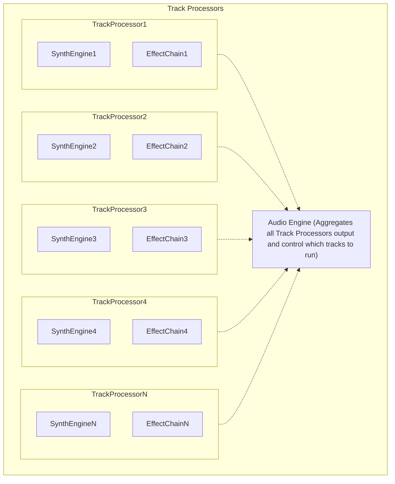
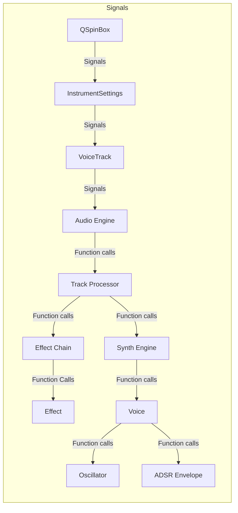
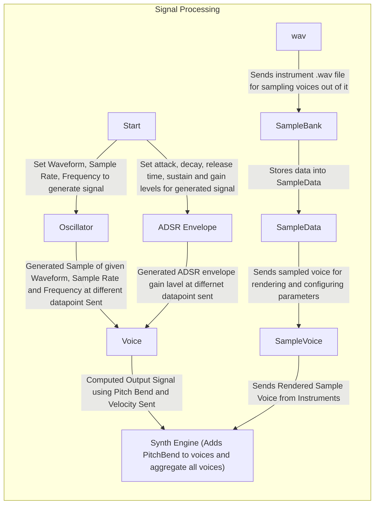
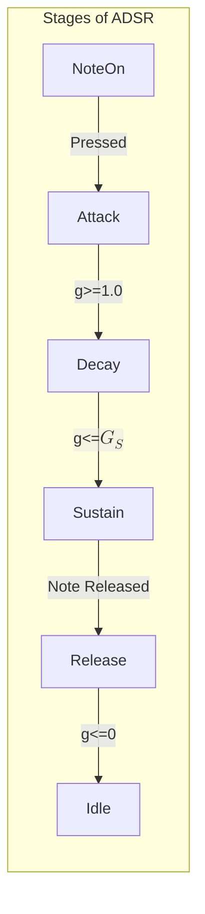

## Build using the command below

``` qt-cmake -S . -B build -G Ninja```

followed by installation with

```
cmake --build build 
```
## Remove build files with
Remove-Item -Recurse -Force build


## If Above command Does not work try below
```cmake -S . -B build -G Ninja `
    -DCMAKE_C_COMPILER=path/to/mingw_64/bin/gcc.exe `
    -DCMAKE_CXX_COMPILER=path/to/mingw_64/bin/g++.exe```

## Install with 
```cmake --build build```

## Start Cliche Station with:

```
    ./build/ClicheStation.exe
``` 
in current directory

## About Cliche Station

Cliche Station is a midi compatible sound engine that uses the midi info inputed through a Midi Keyboard or other Midi devices and processes the digital signal to produce sound suitable for EDM and digital signal processing. It offers a wide range of processing capabilities on waveform like
changing velocity, Attack-Decay-Sustain-Release Envelope, compressing, clipping, reverb, pitchbending, distorting, flanging and modulating the signal. It offers upto 12 different reorderable Audio Effects -
- Chorus
- Clipping
- Compression
- Delay
- Distortion
- EQ
- Flanger
- Gate
- Limiter
- Phaser
- Reverb
- Saturation


## How it works

Cliche Station uses RtMidi (a cross platform Open Source Midi Library) to input sound from a Midi compatible Keyboard device.

It has the following layout

```
root/
    ---assets/
        ---drums/
            ---china,png
            ---hand_clap.png
            ---crash_1.pg
            ---hh_closed.png
            ---hh_open.png
            ---kick.png
            ---snare.png
            ---stick_click.png
            ---ride.png
            ---tom_1.png
        ---icons/
            ---cliche_station.png
        ---app.rc
        ---resources.qrc
    ---audio/
        ---AudioEngine.cpp // contains the Synthesized sound with AudioEffects
        ---AudioEngine.h
        ---TrackProcessor.cpp // contains individual track specific settings
        ---TrackProcessor.h
        ---effects/
            ---AudioEffect.h // Base Class of all audio effects (clipping, delay, distortion, saturation)
            ---AudioEffectFactory.cpp // A Factory class fot creating several audio effects (now 12)
            ---AudioEffectFactory.h
            ---Chorus.cpp // Adds chorus effect
            ---Chorus.h
            ---Clipping.cpp // Produces clipping effect
            ---Clipping.h
            ---Compression.cpp // Add compression to sound
            ---Compression.h
            ---Delay.cpp // Adds dealy effect 
            ---Delay.h
            ---DeEsser.cpp // Removes excessive sibilance (ch, sh, t sound)
            ---DeEsser.h
            ---Distortion.cpp // Adds distortion to the sound
            ---Distortion.h
            ---EffectChain.cpp // Chains all effects in a order
            ---EffectChain.h
            ---EQ.cpp // EQ effects
            ---EQ.h
            ---Flanger.cpp // Adds flanging effects
            ---Flanger.h
            ---Gate.cpp // Adds gate effect
            ---Gate.h
            ---Limiter.cpp // Limits audio 
            ---Limiter.h
            ---Phaser.cpp // Adds Phaser effects
            ---Phaser.h
            ---Reverb.cpp // Adds Reverb 
            ---Reverb.h
            ---Saturation.cpp // Adds saturation
            ---Saturation.h
    ---gui/
        ---base.cpp // Main Window of the application
        ---base.h
        ---DrumGrid.cpp // Grid representing the order of drum beats
        ---DrumGrid.h
        ---drumPad.cpp // Drum Pad layout
        ---drumPad.h
        ---DrumSequence.cpp // Sequence of drums beaten
        ---DrumSequence.h
        ---effect_chain_editor.cpp // Allows Effect Reordering by Swapping
        ---effect_chain_editor.h 
        ---effect_slot.cpp // Contains reorderable slots
        ---effect_slot.h
        ---instrument_settings.cpp //InstrumentSettingscard
        ---instrument_settings.h
        ---main.cpp // entry point of the program. Contains QtStyles
        ---monitorWindow.cpp // window to connect to Midi Keyboard
        ---monitorWindow.h
        ---piano.cpp // piano layout incorporating piano roll and keyboard
        ---piano.h
        ---pianoKeyboard.cpp // Piano Keyboard Gui
        ---pianoKeyBoard.h
        ---pianoRoll.cpp // Synthesia or Piano Roll contains green Piano Tiles
        ---pianoRoll.h
        ---RecordingTimeRuler.cpp // Provides a Time reference for the audio clip to play
        ---RecordingTimeRuler.h
        ---RowContainer.cpp // Contains the RowHeader and StepGrid
        ---RowContainer.h
        ---RowHeader.cpp // Contains the header name of the grid
        ---RowHeader.h
        ---StepGrid.cpp // Contains the grid steps
        ---StepGrid.h
        ---track_list.cpp // The bottom sheet containing voice tracks
        ---track_list.h
        ---voice_track.cpp // Voice Track card
        ---voice_track.h
        ---VoiceRecordingWindow.cpp // window used for editing recorded audio clips
        ---VoiceRecordingWindow.h
        ---playlist/
            ---Clip.cpp // class defining the structure of a clip
            ---Clip.h
            ---ClipArea.cpp // class defining the Cliparea on the right pane of Playlist
            ---ClipArea.h
            ---ClipVisualizer.cpp // Visualiser for Clip
            ---ClipVisualizer.h
            ---Layer.cpp // Several layers form a Sequence
            ---Layer.h
            ---Playlist.cpp // Playlist is a collection of Sequence. (or a collection of song or music piece)
            ---Playlist.h
            ---Sequence.cpp // A collection of several layers whch we may call a song or single music piece
            ---Sequence.h
            ---TimelineView.cpp // Contains the timeline reference for the Clip
            ---TimelineView.h
            ---TimelineWidget.cpp // A widget that displays timeline
            ---TimelineWidget.h
            ---TimeRuler.cpp  // A ruler that tells time reference
            ---TimeRuler.h


    ---midi/
        ---MidiInput.cpp // Accepts midi input from Midi devices using RtMidi apis
        ---MidiInput.h
        ---RtMidi.cpp // RtMidi.cpp file taken from RtMidi github repository providing cross-platform supported midi apis
        ---RtMidi.h
    ---synth/
        ---ADSREnvelope.cpp // Manages ADSR Envelope
        ---ADSREnvelope.h
        ---DrumSampleBank.cpp // Provides input mechanism for the wav files correspoding to Drum Samples
        ---DrumSampleBank.h
        ---DrumsetsSamples.h // Maps drum samples to their wav files
        ---Oscillator.cpp //capable of generating classical Sine, Saw, Triangle, Square and other waves
        ---Oscillator.h
        ---RealTimeSampler.cpp // Contains logic for sampling audios recorded through mic 
        ---RealTimeSampler.h
        ---SampleBank.cpp // Provides input mechanism for the wav files corresponding to instrument samples 
        ---SampleBank.h
        ---SampleData.h // Contains samples rendered from the wav files
        ---SynthEngine.cpp // renders wave profile as described in a Voice object
        ---SynthEngine.h
        ---SynthesizersSamples.h // Maps instrument samples to their wav files
        ---Voice.cpp // object representing a voice as a function of keys pressed frequency, wave velocity, ADSR envelope, oscillator type(Sine, Triangle, Saw) and pitchbend set
        ---Voice.h
    ---wav/
        ---piano-sound-master/
            ---a1.wav
            ---a1s.wav
            ---b1.wav
            ---c1.wav
            ...
            ...
            ...
            ---g1s.wav
        ---Synthesizers/
            ---6 String.wav
            ---12 String.wav
            ---Ac Bass.wav
            ---Bellery.wav
            ---Cellos.wav
            ---Clarinet.wav
            ---Club Piano.wav
            ---Digi Piano.wav
            ---Flute.wav
            ---Harpsichord.wav
            ---JazzOrgan.wav
            ---Music Box.wav
            ---Oboe.wav
            ---Piano.wav
            ---Sitar.wav
            ---Trumpet.wav
        ---Drumsets/
            ---china.wav
            ---crash.wav
            ---hand_clap.wav
            ---hh_close.wav
            ---hh_open.wav
            ---hh_open_stereo.wav
            ---kick.wav
            ---ride.wav
            ---snare.wav
            ---splash.wav
            ---tom.wav
        //contains wavs file for several instruments  
```
```
A Single Voice Track is structured as follows:
VoiceTrack
    │
    ├── PianoRoll
    │
    ├── EffectChain
    │
    └── Synth / instrument settings
              │
              ↓
         SynthEngine
              │
       ┌──────┼──────┐
       ↓      ↓      ↓
     Voice  Voice  Voice
       │      │      │
       ├─ Oscillator
       └─ ADSREnvelope
```

### Content Structure

```
                    horizontal scroll position
                         ↓
                         SHARED TIMELINE
┌───────────────────────────────────────────────────────────────┐
│ Layer-column   │          SHARED TIME RULER                   │
|               0s        1s        2s        3s        4s      |
|                │         │         │         │         │      |
┌───────────────────────────────────────────────────────────────┐
│ ▼ Sequence 1                              [ + Add Layer ]     │
├────────────────┬──────────────────────────────────────────────┤
│ Voice Track 1  │ [ Clip A ]          [ Clip B ]               │
│            [M] │                                              │
├────────────────┼──────────────────────────────────────────────┤
│ Voice Track 2  │       [ Clip C ]                             │
│            [M] │                                              │
├────────────────┼──────────────────────────────────────────────┤
│ Voice Track 3  │                    [ Clip D ]                │
│            [M] │                                              │
├────────────────┴──────────────────────────────────────────────┤
│ ▼ Sequence 2                              [ + Add Layer ]     │
├────────────────┬──────────────────────────────────────────────┤
│ Voice Track 1  │ [ Clip ]                                     │
│            [M] │                                              │
├────────────────┼──────────────────────────────────────────────┤
│ Voice Track 2  │             [ Clip ]                         │
│            [M] │                                              │
└────────────────┴──────────────────────────────────────────────┘
      ↕ vertical scrolling
```

### Reorderable Effects Layout Plan
```
    Effects
┌─────────────────────────────┐
│ ☰  Clipping       [ ON ]    │
├─────────────────────────────┤
│ ☰  Delay          [ OFF ]   │
├─────────────────────────────┤
│ ☰  Distortion     [ ON ]    │
├─────────────────────────────┤
│ ☰  Reverb         [ ON ]    │
└─────────────────────────────┘
The user drags and drops the Effects in some order using the ☰ icon.
```
###  Drum Sequence Architecture

```
    DrumSequence

    │

    ├── QScrollArea

    │     │

    │     └── DrumGrid

    │           │

    │           └── RowContainer

    │                 │

    │                 ├── RowHeaderColumn

    │                 │

    │                 └── HorizontalScrollArea

    │                       │

    │                       └── StepGrid

    │

    └── DrumPad   

```
### TrackProcessor Integral Structure

```mermaid

flowchart LR
subgraph TrackProcessor["TrackProcessor"]
    subgraph VoiceTrack["VoiceTrack"]
        subgraph InstrumentSettings_["Instrument Settings"]
            direction TB
            subgraph ActualSettings["Actual Settings parameters"]
                OscillatorType_["OscillatorType"]
                Volume_["Volume"]
                Frequency_["Frequency"]
                SampleRate_["Sample Rate"]
                Reverb_["Reverb"]
                Distortion_["Distortion"]
                Delay_["Delay"]
            end
            subgraph PreviewKeyboard["Preview Keyboard (Dedicated PianoKeyboard to preview Settings)"]
                MidiNote_P["Midi Note"]
                NoteName_P["Note Name"]
            end
            PreviewKeyboard-->|Ask for Settings|ActualSettings
        end
        subgraph Piano_["Piano"]
            subgraph PianoRoll_["PianoRoll"]
                subgraph PlacedNotes["Placed Notes Vector"]
                    subgraph PlacedNote1["Placed Note 1"]
                        MidiNote1["Midi Note"]
                        Time1["Time Clicked at"]
                        Duration1["Duration"]
                    end
                    subgraph PlacedNote2["Placed Note 2"]
                        MidiNote2["Midi Note"]
                        Time2["Time Clicked at"]
                        Duration2["Duration"]
                    end
                    subgraph PlacedNote3["Placed Note 3"]
                        MidiNote3["Midi Note"]
                        Time3["Time Clicked at"]
                        Duration3["Duration"]
                    end
                    subgraph PlacedNoteN["Placed Note N"]
                        MidiNoteN["Midi Note"]
                        TimeN["Time Clicked at"]
                        DurationN["Duration"]
                    end
                end
            end
            subgraph PianoKeyboard_["Piano Keyboard"]
                subgraph PianoKey["Piano Key"]
                    MidiNote["Midi Note"]
                    NoteName["Note Name"]
                end
            end
        end
        ActualSettings-.->|Provides Settings|Piano_
        
        subgraph InstrumentParameters_["Instrument Parameters"]
            MostlyUnused["Not used at all"]
        end
    end
    subgraph SynthEngines["Synth Engine "]
        subgraph Voice1["Voice 1 (Computes Output from Oscillator and Synth Engine)"]
            Oscillator1["Oscillator 1 (Computes Samples based on SampleRate, Frequency, Waveform phase+Type )"]
            ADSREnvelope1["ADSR Envelope 1 (Computes Gain level of Samples at different ADSR Phase)"]
        end
        subgraph Voice2["Voice 2 (Computes Output from Oscillator and Synth Engine)"]
            Oscillator2["Oscillator 2 (Computes Samples based on SampleRate, Frequency, Waveform phase+Type )"]
            ADSREnvelope2["ADSR Envelope 2 (Computes Gain level of Samples at different ADSR Phase)"]
        end
        subgraph Voice3["Voice 3 (Computes Output from Oscillator and Synth Engine)"]
            Oscillator3["Oscillator 3 (Computes Samples based on SampleRate, Frequency, Waveform phase+Type )"]
            ADSREnvelope3["ADSR Envelope 3 (Computes Gain level of Samples at different ADSR Phase)"]
        end
        subgraph Voice4["Voice 4 (Computes Output from Oscillator and Synth Engine)"]
            Oscillator4["Oscillator 4 (Computes Samples based on SampleRate, Frequency, Waveform phase+Type )"]
            ADSREnvelope4["ADSR Envelope 4 (Computes Gain level of Samples at different ADSR Phase)"]
        end
        subgraph VoiceN["Voice N (Computes Output from Oscillator and Synth Engine)"]
            OscillatorN["Oscillator N (Computes Samples based on SampleRate, Frequency, Waveform phase+Type )"]
            ADSREnvelopeN["ADSR Envelope N (Computes Gain level of Samples at different ADSR Phase)"]
        end
    end
    subgraph EffectChain["Effect Chain (has a process function which when called triggers the non bypassed effects to be triggered in order)"]
    direction TB
    subgraph Effect1["Effect 1 say Clipping"]
        subgraph parameter1["Parameters"]
            Threshold["Threshold"]
        end

        process1["Limits the value of the volume to a threshold variable"]
    end
    subgraph Effect2["Effect 2 say Delay"]
        subgraph parameter2["Parameters"]
            Delay["Delay in Ms"]
            Feedback["Feedback to be added"]
        end
        process2["Not implemented Yet"]
    end
    subgraph Effect3["Effect 3 say Distortion"]
        subgraph parameter3["Parameters"]
            Drive["Drive"]
        end

        process3["Create Distortion as tanh(val*drive)"]
    end
    Effect1-->Effect2
    Effect2-->Effect3
end
end
subgraph AudioEngine["Audio Engine"]
end
```



### Track Processors Process Individual Tracks and sends them to Audio Engine


### Instrument Settings Signals and Functions flow


### Basic Signal Processing without Effects


### New Widget Structure for Playlist
```
    TimelineView
    │
    └── ONE vertical QScrollArea
        │
        └── timelineContent
            │
            ├── leftContent
            |    |___A widget of height as horizontal QScrollArea height+TimeRuler height for padding
            |    |___TimelineRow left part
            |    |___TimelineRow left part
            |    |___TimelineRow left part
            |    |___ ...
            |    |___TimelineRow left part
            │
            └── m_rightContainer
                │
                ├── horizontalScrollBar
                │
                └── m_horizontalScrollArea
                    │
                    └── m_rightContent
                        │
                        ├── TimeRuler       ← scrolls
                        ├── Sequence 1
                        ├── Layer 1
                        ├── Layer 2
                        ├── Layer 3
                        ├── Sequence 2
                        └── ...
```

## Digital Signal Processing Equations

The equations used for the calculation of output signal and envelope are as follows:
$$
\begin{array}{ll}
x[n] : \text{Input signal (mono)} \\
y[n] : \text{Output signal (mono)} \\
x_L[n] : \text{Left input signal (stereo)} \\
x_R[n] : \text{Right input signal (stereo)} \\
y_L[n] : \text{Left output signal (stereo)} \\
y_R[n] : \text{Right output signal (stereo)} \\
f_S : \text{Sample Rate (rate at which samples arrive per sec)} \\
T_A : \text{Duration of Attack stage of signal in sec} \\
T_R : \text{Duration of Release stage of signal in sec} \\


\end{array}
$$
- ADSR Envelope Calculation:
$$
\begin{array}{ll}
    
    T_A : \text{Attack in sec (default 0.8s)} \\ 
    T_D : \text{Decay in sec (default 0.1s)} \\
    G_S : \text{Sustain gain factor (default 0.8)} \\
    T_R : \text{Release in sec (default 0.2s)} \\
    R_{level} : \text{Gain level at which release start} \\
    G_{max} : \text{Peak gain factor (default 1.0)} \\
    g[n] : \text{Gain factor for nth sample} \\ \\
    
    g[0]=0 \\ \\
    g[n] = 
    \begin{cases}
        g[n-1] + \frac{G_{max}}{T_A f_S} &, stage = Attack \\
        g[n-1] - \frac{G_{max}-G_S}{T_D f_S} &, stage = Decay \\
        G_{S} &, stage = Sustain \\
        g[n-1] - \frac{R_{level}}{T_R f_S} &, stage =Release\\
    \end{cases} \\ \\
    y[n]=g[n] \times{} x[n] \\ 

\end{array}
$$



- Chorus:

$$ 
\begin{array}{ll}
f_L : \text{Low frequency oscillator frequency or rate} \\
M : \text{modulation depth} \\
D : \text{base delay}\\
\alpha{} : \text{mix (ranging from 0.0f (only dry) to 1.0f (only wet))}\\
\phi{}_L : \text{low frequency oscillator phase} \\ \\
d[n] : \text{modulated delay} \\ \\
d[n] = D + M \sin{( 2 \pi{}n\frac{ f_L}{f_S}+\phi_{L})} \\ \\
y[n] = (1-\alpha{})x[n] + \alpha{}x[n-d[n]]
\end{array}

$$

- Clipping:
$$
\begin{array}{ll}
    T : \text{Clipping Threshold (between 0.01 to 1.0)} \\ \\
    y[n] = 
    \begin{cases} 
        -T &, x[n]<-T \\
        x[n] &, -T < x[n] < T \\
        T &, T<x[n] \\
    \end{cases} \\

\end{array}
$$

- Compression:
$$
\begin{array}{ll}
T : \text{Threshold in dB} \\
r : \text{Compression ratio (ratio of signal above T which is reduced)} \\
T_A : \text{Attack in sec} \\
T_R : \text{Release in sec} \\
G_{m} : \text{Make up Gain} \\
d[n] : \text{instantaneous detected level} \\ 
e[n] : \text{envelope (uses EWMA)} \\
L[n] : \text{input level  in dB} \\
G_{dB} : \text{Gain reduction} \\
g[n] : \text{Compression gain} \\ \\
d[n] = max(|x_L[n]| , |x_R[n]|)  \\ \\
e[n] = 
\begin{cases}
\exp{}^{-\frac{1}{T_A f_S}}e[n-1]+(1-\exp{}^{-\frac{1}{T_A f_S}})d[n] &, d[n]>e[n]\\
\exp{}^{-\frac{1}{T_R f_S}}e[n-1]+(1-\exp{}^{-\frac{1}{T_R f_S}})d[n] &, d[n]<e[n]\\
\end{cases} \\ \\
L[n] = 20 \log_{10} {e[n]} \\ \\
G_{dB} = \frac{L[n]-T}{r} - (L[n]-T) \\ \\
g[n] = 10^{\frac{G_{dB}}{20}}\\ \\
y_L[n] = x_L[n]g[n]G_{m} \\
y_R[n] = x_R[n]g[n]G_{m} \\
\end{array} \\
$$

- Delay:
$$
\begin{array}{ll}
D : \text{Delay time in sec (Spacing between echo)} \\
f : \text{Feedback (attenuation of each successive echo)} \\
m : \text{mix} \\
b[n] : \text{Buffered feedback} \\ \\
b[n] = x[n] + f b[n-D] \\ \\
y[n] = x[n](1-m)+mb[n-D] \\ 

\end{array} \\
$$

- Distortion:
$$
\begin{array}{ll}
d : \text{Distortion drive} \\ \\
y[n] =tanh(x[n] d)\\

\end{array}
$$

- EQ:
$$
\begin{array}{ll}
    f_{low} : \text{Low frequency} \\
    f_{mid} : \text{Mid frequency} \\
    f_{high} : \text{High frequency} \\
    Q : \text{Q factor} \\
    G_{low} : \text{Low Gain} \\
    G_{mid} : \text{Middle Gain} \\
    G_{high} : \text{High Gain} \\
    A : \text{Gain parameter in RBJ equation} =  10^{\frac{G}{40}} \\
    \omega{} = 2 \pi{} \frac{f}{f_SR} \\
    \alpha{} = \frac{sin( \omega{})}{\sqrt{2}} \\
    b_0 = \frac{A ((A+1)-(A-1) cos(\omega{}) + 2 \sqrt{A} \alpha{} )}{A ((A+1)+(A-1) cos(\omega{}) + 2 \sqrt{A} \alpha{} )} \\ 
    b_1 = \frac{2 A ((A-1)-(A+1) cos(\omega{}))}{- 2 A ((A-1)+(A+1) cos(\omega{}))} \\ 
    b_2 = \frac{A ((A+1) - (A-1) cos(\omega{}) - 2 \sqrt{A} \alpha{})}{A ((A+1) + (A-1) cos(\omega{}) - 2 \sqrt{A} \alpha{})} \\
    y[n] = b_0 +z_1[n-1] \\ \\
    z_1[n] = b_1 x[n] - a_1 y[n] +z_2[n-1] \\ \\
    z_2[n] = b_2 x[n] - a_2 y[n] \\ \\

\end{array}
$$

- Flanger:
$$
\begin{array}{ll}
f_R : \text{Oscillation frequency of LFO} \\
d : \text{Modulation depth} \\
m : \text{mix} \\
f[n] : \text{feedback} \\
D[n] :\text{Delay} \\
D_s[n] :\text{Delay in samples} \\
D_{min} = \text{ Min Delay} \\
D_{max} = \text{ Max Delay} \\
D_s[n] = (D_{min} + \frac{sin(2 \pi{} n \frac{f_R}{f_S})+1}{2} d) f_S \\ \\
\mu{} = \text{Interpolation fraction} = D_s[n] - \lfloor{} D_s[n] \rfloor{} \\ \\
d[n]= b[n-\lfloor{}D_s[n]\rfloor{}] \mu{} + (1-\mu{}) b[n- \lfloor{} D_s[n] \rfloor{}+1] \\ \\
b[n] : \text{Feedback}= x[n]+f_F d[n] \\ \\
y[n]= x[n] (1-m) +(x[n]+f[n-1] D[n] )m \\ \\

\end{array}
$$

- Gate: 
$$
\begin{array}{ll}
T : Threshold \\
range : \text{Range in dB}\\
G_{closed} : \text{Closed gain} \\
G_{target} : \text{Target Gain} \\
g[n] : Gain \\ \\
G_{closed} = 10^{\frac{range}{20}} \\ 
G_{target} = 
\begin{cases}
1 &,\text{ x[n]>T} \\
G_{closed} &, \text{ x[n]< T} \\
\end{cases} \\ \\

g[n] =
\begin{cases}
G_{target}+ (g[n-1] - G_{target}) e^{-\frac{1}{T_A f_S}} &,  G_{target} > g[n-1] \\
G_{target}+ (g[n-1] - G_{target}) e^{-\frac{1}{T_R f_S}} &,  G_{target} < g[n-1] \\

\end{cases}\\ \\

y[n]=g[n]*x[n] \\
\end{array}
$$

- Limiter:
$$
\begin{array}{ll}
T : \text{Threshold} \\
T_R : \text{Release in sec} \\
C : \text{Ceiling} \\ 
x_p[n] : \text{Input peak} = max(|x_L[n]|, |x_R[n]|) \\ 
g_{target} : \text{Target gain} = min(1, \frac{T}{x_p[n]}) \\
g[n] : \text{ Gain } \\
g[n] = g_{target} + (g[n-1] - g_{target}) e^{-\frac{1}{T_R f_S}} \\ \\
y_L[n]= 
\begin{cases}
    -C &, x_L[n]g[n] < -C \\
    x_L[n]g[n] &, -C < x_L[n]g[n]<C \\
    C &, C < x_L[n]g[n] \\
\end{cases} \\ \\
y_R[n]= 
\begin{cases}
    -C &, x_R[n]g[n] < -C \\
    x_R[n]g[n] &, -C < x_R[n]g[n]<C \\
    C &, C < x_R[n]g[n] \\
\end{cases} \\
\end{array}
$$

- Phaser:

$$
\begin{array}{ll}
f_{R} : \text{Oscillation Frequency of LFO} \\
d : \text{Modulation depth} \\
f : \text{Feedback} \\
f_{min} : \text{Min all-pass frequency} \\
f_{max} : \text{Max all-pass frequency} \\
m : \text{Mix} \\
v_0[n], v_1[n],...,v_k[n] : \text{Input to k stages for nth sample} \\
s_0[n], s_1[n],...,s_k[n] : \text{State of k stages for nth sample} \\
y_0[n], y_1[n],...,y_k[n] : \text{Output of k stages for nth sample} \\
\omega{} : sin(2 \pi{} \frac{f_R}{f_S}) \\

a[n] : \text{All-pass coefficient} = \frac{1-sin(\omega{}n)}{1+sin(\omega{}n)}\\
l[n] : \text{Low Frequecy Oscillator} \\ \\
l[n] = \frac{1 + sin(\omega{}n)}{2} \\ \\
f[n] = f_{min} + d l[n] ( f_{max}- f_{min}) \\ \\
v_0[n] = x[n] +  y_N[n-1] f \\
s_k[n] = v_k[n]+ a[n] y_k[n] \\
y_k[n] = -a[n]v_k[n] + s_k[n-1] \\ 
v_{k+1}[n] = y_k[n] \\
y[n] = (1-m)x[n]+my_N[n] \\
\end{array} \\ \\ 

$$

- Reverb:

$$
\begin{array}{ll}
R : \text{Room Size} \\
D : \text{damping} \\
w : \text{Wet mix component of reverb} \\ 
\delta{}_1, \delta{}_2, \delta{}_3, \delta{}_4 : \text{Delayed signal used for echo} \\ \\
\delta{}_1 = f_S (0.029 + 0.02 R) \\
\delta{}_2 = f_S (0.043 + 0.03 R) \\
\delta{}_3 = f_S (0.071 + 0.04 R) \\
\delta{}_4 = f_S (0.113 + 0.05 R) \\ \\
r[n] = \frac{x[n-\delta{}_1]+x[n-\delta{}_2]+x[n-\delta{}_3]+x[n-\delta{}_4]}{4} \\ \\
r_D[n] = (1-D)r[n] \\ \\
y[n] = (1-w)x[n] + w r[n] \\
\end{array} \\
$$

- Saturation:

$$
\begin{array}{ll}
d : \text{Saturation Drive} \\
y[n]= tanh(x[n] drive)
\end{array}
$$